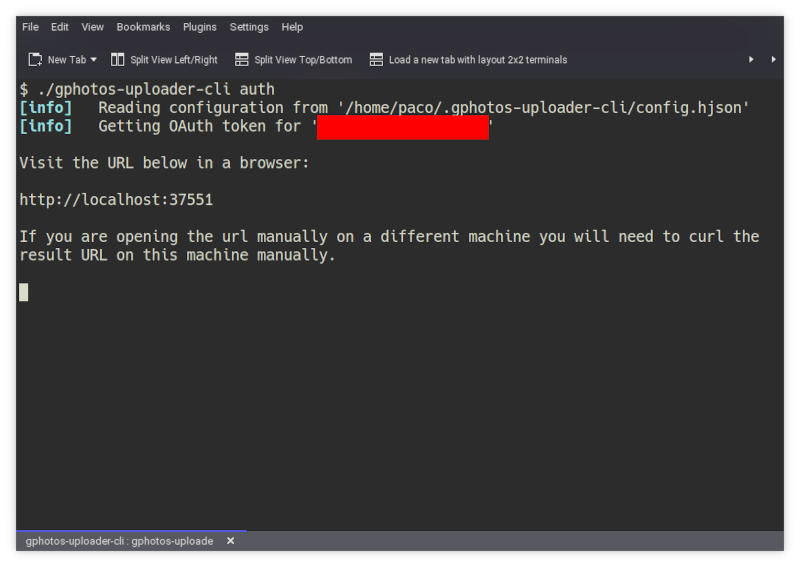
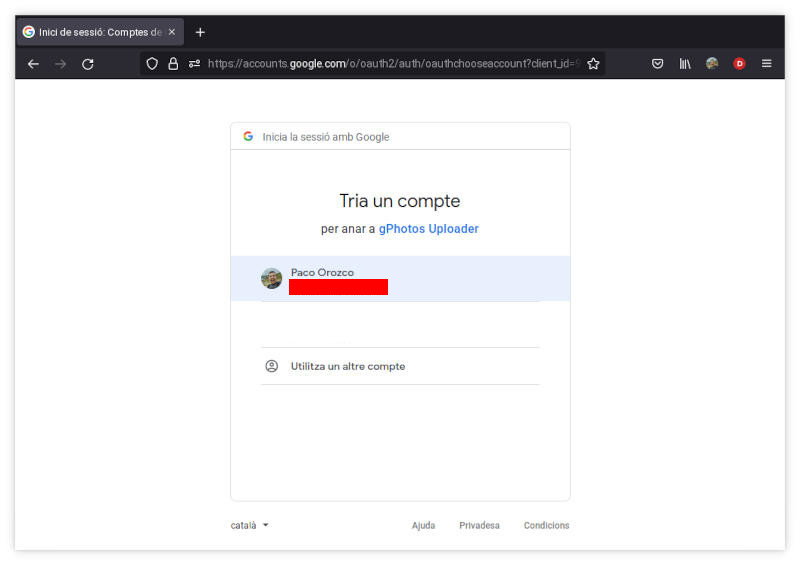
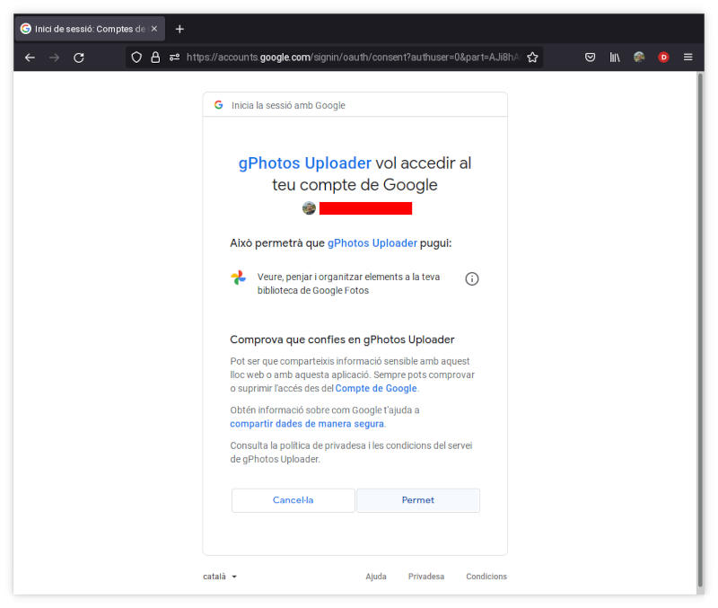
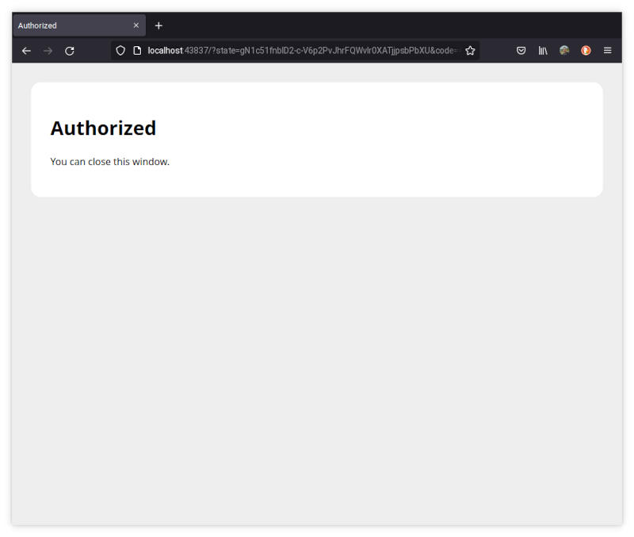
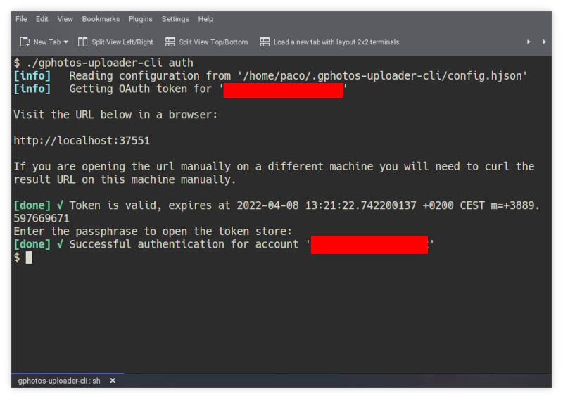

# Getting started

## Install

You can install the pre-compiled binary (in several different ways) or compile from source.

Here are the steps for each of them:

### Install the pre-compiled binary

#### homebrew tap (only on macOS for now)

```bash
brew install gphotosuploader/tap/gphotos-uploader-cli
```

#### manually

Download the pre-compiled binaries from the [releases page](https://github.com/gphotosuploader/gphotos-uploader-cli/releases/latest) and copy to the desired location.

For Linux:

```bash
LOCATION=$(curl -s https://api.github.com/repos/gphotosuploader/gphotos-uploader-cli/releases/latest \
| grep browser_download_url \
| awk '{ print $2 }' \
| tr -d \" \
| grep linux); wget --quiet -O - $LOCATION | tar -zxf -
```

For macOS:

```bash
LOCATION=$(curl -s https://api.github.com/repos/gphotosuploader/gphotos-uploader-cli/releases/latest \
| grep browser_download_url \
| awk '{ print $2 }' \
| tr -d \" \
| grep darwin); curl -sL $LOCATION | tar -zxf -
```

### Compiling from source

> This project maintains compatibility with the last two published Go releases (e.g. 1.26 and 1.27). It may work with other versions, but they are not supported.

You can compile the source code in your system.

```bash
git clone https://github.com/gphotosuploader/gphotos-uploader-cli \
&& cd gphotos-uploader-cli \
&& make build
```

Or you can use `go install` if you prefer it (the binary is placed in `$(go env GOPATH)/bin`):

```bash
go install github.com/gphotosuploader/gphotos-uploader-cli@latest
```

## Configure

First initialize the config file using this command:

```bash
gphotos-uploader-cli init
```

> Default configuration folder is `~/.gphotos-uploader-cli` but you can specify your own folder using `--config /my/config/dir`. Configuration is kept in the `config.hjson` file inside this folder.

You must review the [documentation](configuration.md) to specify your **Google Photos API credentials**, `APIAppCredentials`. You should tune your `jobs` configuration also.

## Authentication

Once it's configured, you need to authenticate your CLI against Google Photos:

```bash
gphotos-uploader-cli auth
```

The CLI starts a small local web server and waits for Google to redirect your browser back to it, so a few manual steps are needed:

1. The CLI prints a `http://127.0.0.1:<port>` URL to visit. By default, a random free port is used:

   

1. Open that URL in a browser on the same machine. You are redirected to Google: select the account to authenticate the CLI with (the same one you configured in the config file):

   

1. Confirm that you trust `gphotos-uploader-cli` to access your Google Photos account by clicking **Allow**:

   

1. Google redirects your browser back to the CLI, which receives the authorization automatically. There is nothing to copy; you can close the browser:

   

1. Go back to your terminal window. The authentication process is complete:

   

### Authenticating on a remote or headless machine

The CLI is not designed for headless setups, but several users have confirmed it works. The browser must be able to reach the CLI's local server, so use a **fixed port** and forward it from your local machine.

**Option 1: SSH tunnel (recommended).** On the remote machine, run the CLI with a fixed port:

```bash
gphotos-uploader-cli auth --port 37551
```

From your local machine, open an SSH tunnel to the remote machine using the same port:

```bash
ssh -L 37551:localhost:37551 myremotehost
```

Then open the URL printed by the CLI in your local browser.

**Option 2: Direct connection.** If your browser can reach the remote machine over the network, make the server listen on a reachable address and tell Google where to redirect:

```bash
gphotos-uploader-cli auth --local-bind-address 0.0.0.0 --port 8080 --redirect-url http://myhost:8080
```

| Flag                   | Default     | Description                                                                                  |
|------------------------|-------------|----------------------------------------------------------------------------------------------|
| `--port`               | `0`         | Port the local server listens on. `0` picks a random free port.                              |
| `--local-bind-address` | `127.0.0.1` | Address the local server listens on.                                                         |
| `--redirect-url`       |             | URL Google redirects to after authentication, e.g. `http://myhost:8080`. Requires `--port`.  |

> Since v6.0.0, `--redirect-url-hostname` has been removed. Use `--redirect-url` with the full URL instead. See [UPGRADING](upgrading).

## Upload your files

Once you are authenticated, upload your files with:

```bash
gphotos-uploader-cli push
```

The CLI processes every job in your [configuration](configuration.md#jobs), one after another. For each job it:

1. Scans the `SourceFolder` and picks the files that match your [include and exclude patterns](configuration.md#including-and-excluding-files).
1. Skips files that were already uploaded on a previous run.
1. Creates the destination [album](configuration.md#album) if it doesn't exist yet, then uploads the files to it.
1. Deletes each local file after a successful upload, but only if [`DeleteAfterUpload`](configuration.md#deleteafterupload) is enabled.

At the end of each job, it prints how many files were processed and how many failed. If one file fails, the CLI logs the error and moves on to the next one.

### Preview what will be uploaded

Use `--dry-run` to see what `push` would do without uploading or deleting anything:

```bash
gphotos-uploader-cli push --dry-run
```

> Albums are still created in dry-run mode. Add `--debug` to list each file that would be uploaded.

### Running push again

Run `push` as often as you like, for example from a cron job. Files that were already uploaded are skipped, so only new or modified files are sent to Google Photos.

The CLI keeps track of uploaded files in a local database in your configuration folder. A file counts as already uploaded if its modification time hasn't changed or, if it has, its content is still the same.

To upload everything again, reset that database:

```bash
gphotos-uploader-cli reset file-tracker
```

Large uploads resume where they stopped if a run is interrupted.

### Google Photos daily quota

The Google Photos API limits how many requests you can make per day. When that limit is reached, `push` stops with a "quota exceeded" error. Run it again later (the quota resets daily) and it continues with the files that weren't uploaded yet.

### Flags

| Flag        | Default                   | Description                                                      |
|-------------|---------------------------|------------------------------------------------------------------|
| `--dry-run` | `false`                   | Show what would be uploaded without uploading or deleting files. |
| `--config`  | `~/.gphotos-uploader-cli` | Configuration folder to use.                                     |
| `--debug`   | `false`                   | Log very verbose information, one line per file.                 |
| `--silent`  | `false`                   | Hide all log output except panics.                               |
